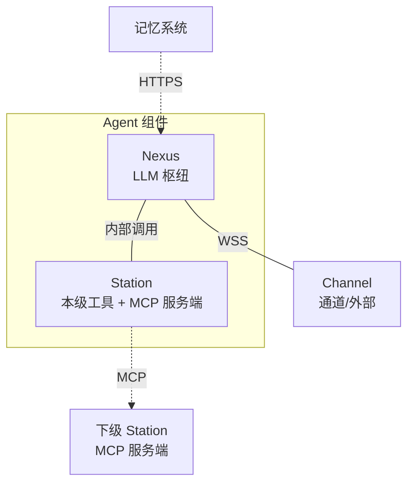

# system-design-agent 组件设计

## 概述
Agent 是智能体组件，内部由两个模块组成——Nexus（LLM 通信枢纽）和 Station（Tool 执行主机）。Nexus 负责"思考"——与 LLM 通信处理输入输出，对接记忆系统；Station 负责"行动"——执行具体工具操作。nexus 通过内部调用与同进程 station 通信；Station 之间通过 MCP（Streamable HTTP 单端点）通信。

Agent 程序当前启动时同时装配 Nexus 与 Station（Station 单例 + station MCP 服务端，可被远程 station 作为 sub 调用）；仅 nexus / 仅 station 的裁剪形态为后续能力。

## 核心功能

1. **LLM 驱动的智能对话**：从记忆系统读取上下文，调用 LLM 生成回复，将 tool call 分派到 station 执行
2. **工具执行**：通过 station 执行具体的工具操作（文件操作、命令执行、网络搜索等）
3. **分布式运行**：支持 nexus 和 station 各自独立部署运行，station 之间通过 MCP 通信

## 内部模块

### Nexus（LLM 通信枢纽）
- 每个 nexus 实例连接多个 provider（按 provider 配置分派 OpenAI 兼容 / Anthropic 实现）
- 负责会话定位与会话上下文构建，串接 pipeline 体系（输入处理 / 消息发送 / 工具调用 / 输出处理 / 系统提示词）
- 处理 LLM 输出，将 tool call 分派到 station
- 支持两种记忆模式（角色记忆/事件记忆）

详见 [kissbot-agent-nexus 内部设计](components-design/kissbot-agent-nexus.md)

### Station（Tool 执行主机）
- 每 agent 一个**全局单例**，启动时从配置构建
- 同时是 **MCP 服务端**（对外提供工具发现与工具调用）与 **MCP 客户端**（经 MCP 调用直接子 Station）
- **嵌套结构**：本级 **group 集合**（每组含工具元数据与可选的本地实现）+ 直接**子 Station 集合**（仅连接信息，MCP 通信）；子 Station 只存直接子，孙子由子进程递归
- 工具元数据**递归平铺**（本级 group 白名单过滤 + 直接子经 MCP 实时拉取并更新工具路由），工具名 group 内唯一，跨 group/跨子站重名合并时保留先到者
- 内置 filesystem group（read 工具，配置显式声明 group 名才注册）
- 接收来自 nexus 的 tool call 并执行
- 不直接与 LLM 通信
- 不直接对接记忆系统（tool 结果由 nexus 统一推送记忆）
- 可运行在通用服务器、网络设备、智能家电、机器人等多种形态上

详见 [kissbot-agent-station 内部设计](components-design/kissbot-agent-station.md) 与 [技术规格](../spec/kissbot-agent-station.md)

### 记忆系统
- 由 nexus 对接记忆系统
- 两种组织模式：角色记忆由角色标识，事件记忆由角色和事件共同标识
- nexus 按标识粒度和记忆系统通信

详见 [kissbot-memory 组件设计](components-design/kissbot-memory.md)

### 配置管理器
配置按三分结构管理：
- **公共配置（静态）**：各组件共享的 `config.json`（kissbot-config 只读单例）。agent 相关段为 `agent`（`data_dir`、`mgmt_host`、`mgmt_port`、`station_host`、`station_port`、`ws_reconnect_interval_secs`）与 `api`（memory-store / memory-ego 地址）；密钥在 `security` 段
- **NexusRepo / StationRepo（可改、落盘）**：可修改并持久化。NexusRepo 存 channels / providers+models / memory_structs / (agent, role) 配置 / session 配置（见 [kissbot-agent-nexus 技术规格](../spec/kissbot-agent-nexus.md)），StationRepo 存 groups / sub_stations（见 [kissbot-agent-station 技术规格](../spec/kissbot-agent-station.md)）
- **运行态（不落盘）**：会话上下文、pipeline 装配、channel 运行态（mode / client / 未回显 msg_id）等，由 Nexus 与其组件在内存中持有

## 组合模式

Agent 启用不同的内部模块和记忆模式，形成多种工作方式：

| 启动模式 | 记忆模式 | 典型场景 |
|----------|----------|----------|
| 仅 nexus | 事件记忆 | 纯 LLM 问答，无需工具执行，每次对话为一个独立事件 |
| nexus + station | 事件记忆 | LLM 对话配合工程工具（文件操作、命令执行），每个工程任务为一个独立事件 |
| 多 nexus + 多 station | 角色记忆 + 事件记忆 | 有统一记忆的分布式 agent，持续收集信息、与人交互，并可独立完成专项 |

## 内部模块关系

Agent 组件内部包含两大模块：

**Nexus 模块**：负责 LLM 通信、会话编排和记忆对接
- LLM 客户端（provider 体系）：按 provider_type 分派 OpenAI 兼容 / Anthropic 实现，封装调用与响应归一化
- pipeline 体系：按会话装配输入处理器、消息发送器、工具调用器、输出处理器与系统提示词器（装配时注入会话，运行期直接读写该会话上下文），AgentPipeline 即 agentic loop 本体
- 会话与上下文：按 (agent_id, role_name, mode) 管理上下文（内存 + 本地缓存 + 历史归档）
- Tool 调用分派：把外置工具分派到 Station（工具分组白名单平铺查询 + 工具调用）
- 记忆读写：上行消息 / 回复 / 思考 / tool call & result 写入记忆；上下文超长时按配置压缩或从记忆回溯
- 外部输入处理器：对接消息通道（经通道适配层），管理命令路由

**Station 模块**：负责工具执行
- 全局 Station 单例：本级工具索引 + 直接子 Station 集合（工具名 group 内唯一，跨 group 重名收敛）
- ToolImplement / NativeTool：本级原生工具实现接口与其工具条目（元数据 + 实现）；Group 为一组原生工具
- 子 Station：仅连接信息 + MCP 客户端；Station 自身也作为 MCP 服务端被其他 station 调用
- 内置注册表：filesystem → read 工具
- 工具执行器：接收并执行工具调用（本级原生实现 → 工具路由 → 对应子 Station 的 MCP 调用）
Nexus 通过内部调用与全局 Station 单例通信（工具分组白名单查询 tools_for_session / 工具调用 Station::call_tool_local），Station 之间通过 MCP 通信。Agent 启动时装配 Nexus 与 Station。
