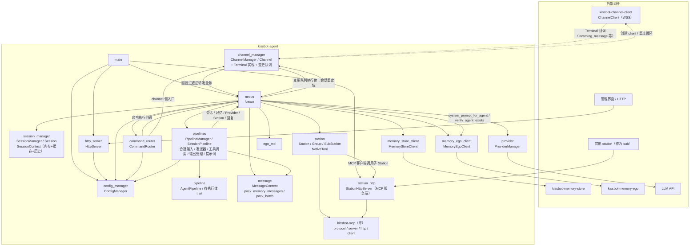
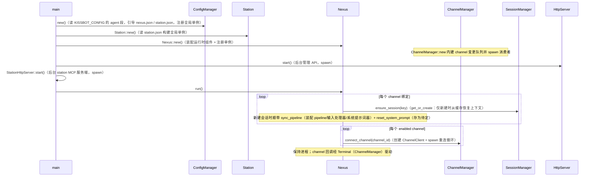
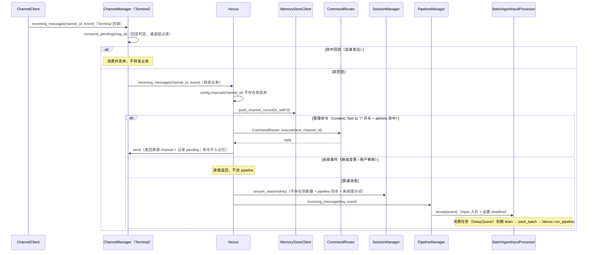
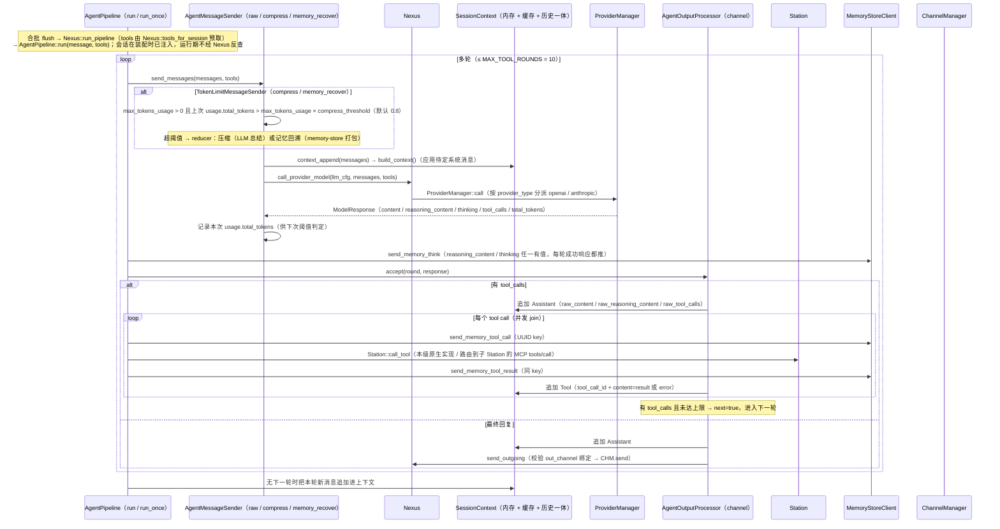
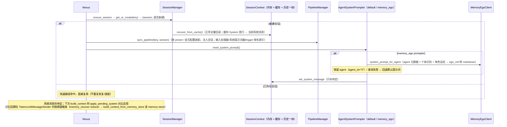

# kissbot-agent 组件调用关系

> 说明 kissbot-agent（后台 Rust 实现）内部各模块之间的调用关系，以及与外部的交互边界。
> 代码位置：`kissbot-agent/src/`。整体技术栈与部署形态见 [technical-architecture.md](technical-architecture.md)。

## 一、组件清单

| 模块 | 关键类型 | 职责 | 主要调用方 / 依赖 |
|------|----------|------|-------------------|
| main | — | 启动入口：加载配置、构建全局单例（ConfigManager → Station → Nexus）、spawn 管理 API 与 station MCP 服务端、进入主循环 | 调 ConfigManager / Station / Nexus / HttpServer / StationHttpServer |
| config_manager | ConfigManager | 配置加载与读写（channels / providers+models / memory_structs / (agent, role) 配置 / session 配置 / station / admin）；合成 provider+model 与 (agent, role)+session 的有效配置 | 被几乎所有模块调用 |
| nexus | Nexus | **编排中心**：消息业务处理（管理命令分发 / 普通消息路由）、会话定位与构建、通道连接调度、回复发送、全局单例装配 | 持有全部运行时组件；被 channel_manager（Terminal 回调和变更消费者）、pipelines（回调 Nexus 单例）调用 |
| channel_manager | ChannelManager / Channel | **Terminal 实现**（通道适配层：回显过滤 + 转发业务）；每 channel 运行态（pending msg_id 回显判定、mode、client、断线通知）；连接 / 重连 / 发送封装；channel 变更串行队列（含执行体） | 被 nexus 调用；被 channel-client 回调（Terminal）；队列消费者回经 Nexus 做会话重定位 |
| session_manager | SessionManager / Session / SessionContext | 会话三元组去重创建（返回 `(Session, 是否新建)`）；会话上下文一体管理（SessionContext：内存消息 + 本地缓存 + 历史归档，三者格式一致） | 被 nexus 调用 |
| pipeline | AgentPipeline / AgentTrigger / Agent{Input,Message,Tool,Output}… 等 trait | 定义 agentic loop 的执行体抽象：输入处理器、消息发送器、工具调用器、输出处理器、系统提示词器，以及无手动触发的 trigger 标记 trait；AgentPipeline 装配时注入会话并直接读写其上下文 | 被 pipelines 实现/组合；AgentPipeline::run 是 agentic loop 本体 |
| pipelines | PipelineManager / SessionPipeline / BatchAgentInputProcessor / TokenLimitMessageSender / ChannelOutputProcessor / DefaultSystemPrompter … | pipeline 体系实现与注册表：按会话 key 装配（装配时注入会话；输入处理器 / 系统提示词器 / trigger 为按名索引的多实例集合，运行中的 pipeline 另有独立锁）、工厂与 preset 映射、保留/清理；合批输入（mpsc + DelayQueue）在 flush 时回调 `Nexus::run_pipeline` | 被 nexus 调用；实现体回调 Nexus 单例（Provider、记忆、Station、回复发送） |
| command_router | CommandRouter | 管理命令解析与执行（/bind、/unbind、/admin、/unadmin、/agent、/role、/mode、/bind-outgoing、/unbind-outgoing、/model） | 被 nexus 调用；执行时读 config、调 nexus / channel_manager |
| message | MessageContent / pack_memory_messages / pack_batch | 消息内容组装：extract_content（record/event → 文本段）、记忆交替序列打包、batch → 单条 User 打包 | 被 memory_store_client / nexus（记忆回溯打包）/ pipelines（合批 flush）调用 |
| memory_store_client | MemoryStoreClient | memory-store 读写：推记录（channel / think / tool_call / tool_result，写入经 appender 批量投递）+ 读记忆（最近 N + 时间段两次查询并集打包） | 被 nexus 调用 |
| memory_ego_client | MemoryEgoClient | ego REST 客户端（agent / individual / role 查询）；system_prompt_for_agent / verify_agent_exists 经它发请求 | 被 nexus 调用 |
| provider | ProviderManager / OpenAiProvider / AnthropicProvider | 按 provider 配置分派实现：构造请求、调用 API、归一化响应（含 thinking / reasoning_content / tool_calls / usage）；模型列表查询 | 被 nexus 调用（`call_provider_model` / `list_models`） |
| station | Station / Group / GroupTool / SubStation / NativeTool / McpClient | 全局 Station 单例：本级 group 集合（工具元数据 + 原生实现，由内置注册表按 group 名填充）+ 直接子 Station（仅连接信息，持 McpClient）；实现 McpHandler（server/discover / tools/list / tools/call），list_tools(filter, ancestors) 平铺查询 / call_tool | 被 nexus（工具分组白名单）与 pipelines（工具调用适配层）调用；被 station_http 挂载为 MCP 处理器 |
| station_http | StationHttpServer / McpServer | station 对外 MCP 服务端（kissbot-mcp 的 McpServer + 单端点 `POST /mcp`，方法 server/discover / tools/list / tools/call），认证走 security.api_key | 被 main 调用；供其他 station 作为 sub 调用 |
| ego_md | build_ego_identity_md / build_ego_individual_recognition_md / build_role_play_md | ego 结构 → 系统提示词 markdown | 被 nexus（system_prompt_for_agent）调用 |
| http_server | HttpServer | 管理 API（config CRUD），认证走 kissbot-security | 被 main 调用；仅操作 ConfigManager |
| types | Mode / Message / SessionKey / ToolCall / ChannelCommand / ModelResponse … | 共享数据类型 | 被几乎所有模块引用 |

## 二、组件调用关系总览

## 三、启动流程

## 四、上行消息处理

## 五、Agentic Loop（LLM 回复 / 工具调用）

## 六、会话构建与上下文管理

## 七、对外交互边界

| 方向 | 组件 | 协议 | 说明 |
|------|------|------|------|
| agent → channel | kissbot-channel-client | WSS | agent 作为客户端连接消息通道；ChannelClient 持 `Weak<dyn Terminal>` 回调 ChannelManager（Terminal 实现：incoming_message / join_group / leave_group / user_removed / download_chunk / closed）；ChannelManager 回显过滤后转 Nexus |
| agent → memory-store | kissbot-memory-store | HTTP | MemoryStoreClient 推记录（`/store/*`）+ 读记忆（`/store/query/channel*`） |
| agent → memory-ego | kissbot-memory-ego | HTTP | MemoryEgoClient 查询（`/agent/get`、`/individual/get-all`、`/role/get`）；system_prompt_for_agent / verify_agent_exists 经它发请求 |
| agent → LLM | 模型提供方 API | HTTP | ProviderManager 按 provider_type 分派（openai: `/chat/completions`、anthropic: `/v1/messages`），支持重试、工具调用、thinking/reasoning 回传 |
| agent ← 管理界面 | HttpServer | HTTP | 当前仅 config CRUD（操作 ConfigManager）；管理命令走 channel 消息（/ 开头） |
| agent ← station（sub） | StationHttpServer | MCP（Streamable HTTP） | 单端点 `POST /mcp`，供其他 station 作为 sub 调用（server/discover、tools/list、tools/call），认证 security.api_key |

## 八、未接线 / 预留

- **无手动触发的 trigger（`SessionPipeline.triggers`）**：类型与保留位已建（`AgentTrigger` 标记 trait），当前装配时为空列表，尚无生产实现。
- **memory-struct**：`NexusRepo.memory_structs` 与 `MemoryStructConfig` 仅建结构，无消费方（记忆索引 / 记忆搜索工具未实现；上下文回溯走 memory-store 的两查询并集）。
- **Terminal（ChannelManager）的 join_group / leave_group / user_removed / download_chunk**：回调为 no-op / 未使用，业务逻辑预留。
- **`ModelResponse.finish_reason`**：已解析但无消费方（截断等停止原因不触发额外处理）。
- **http_server ↔ nexus**：管理命令（/bind、/mode 等）目前由 channel 上行消息触发，HttpServer 未直接调用 nexus。
- **配置热更新监听**：ConfigManager 未提供变更监听，接入 Station/Nexus 为遗留事项。
