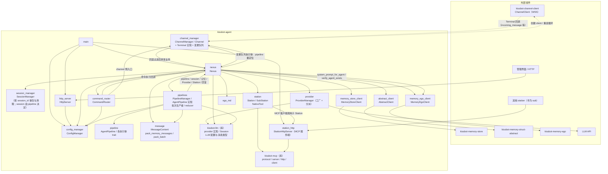
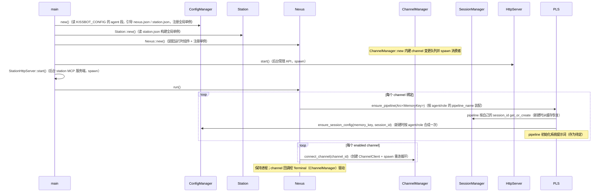
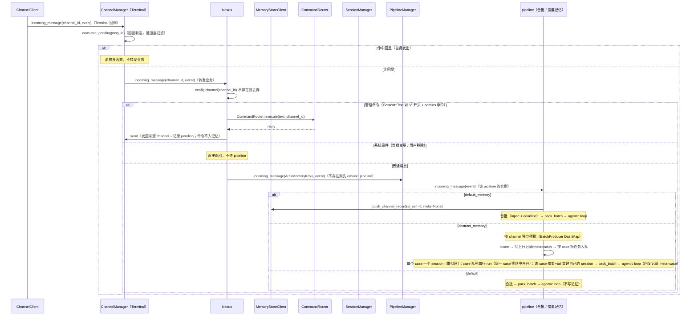
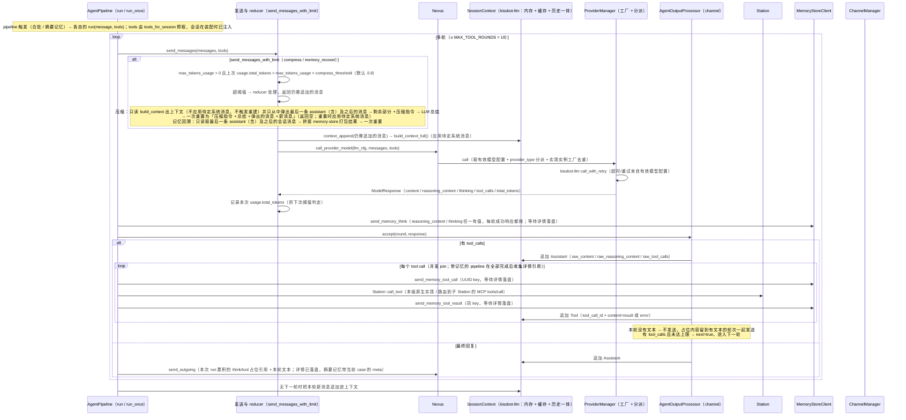
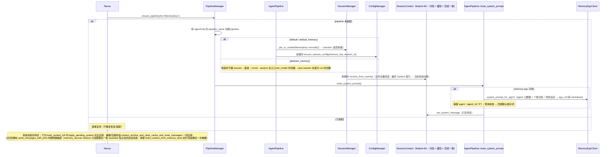

# kissbot-agent 组件调用关系

> 说明 kissbot-agent（后台 Rust 实现）内部各模块之间的调用关系，以及与外部的交互边界。
> 代码位置：`kissbot-agent/src/`。整体技术栈与部署形态见 [technical-architecture.md](technical-architecture.md)。

## 一、组件清单

| 模块 | 关键类型 | 职责 | 主要调用方 / 依赖 |
|------|----------|------|-------------------|
| main | — | 启动入口：加载配置、构建全局单例（ConfigManager → Station → Nexus）、spawn 管理 API 与 station MCP 服务端、进入主循环 | 调 ConfigManager / Station / Nexus / HttpServer / StationHttpServer |
| config_manager | ConfigManager | 配置加载与读写（channels / providers+models / memory_structs / (agent, role) 配置 / session 配置 / station / admin）；建立 session 时按 memory_key 的 agent/role 合成一次 session 配置，读取按 session_id，pipeline 选择按 (agent, role) 合成 | 被几乎所有模块调用 |
| nexus | Nexus | **编排中心**：消息业务处理（管理命令分发 / 普通消息路由）、pipeline 定位与装配、通道连接调度、全局单例装配 | 持有全部运行时组件；被 channel_manager（Terminal 回调和变更消费者）、pipelines（回调 Nexus 单例）调用 |
| channel_manager | ChannelManager / Channel | **Terminal 实现**（通道适配层：回显过滤 + 转发业务）；每 channel 运行态（pending msg_id 回显判定、event、client、断线通知）；连接 / 重连 / 发送封装；channel 变更串行队列（含执行体） | 被 nexus 调用；被 channel-client 回调（Terminal）；队列消费者回经 Nexus 做 pipeline 重定位 |
| session_manager | SessionManager | 按 session_id（`ArcStr`）去重创建（返回 `(Session, 是否新建)`）、按 id 清理；session 数量与 id 由 pipeline 决定 | 被 nexus 与 pipeline 调用；持有 kissbot-llm 的 Session |
| pipeline | AgentPipeline / IncomingMessageProcessor / IncomingMessageBatchProcessor / TokenReducer | 定义 pipeline 的执行体抽象：消息接入（单条 / 整批）、token 压缩；`AgentPipeline` 提供 `reset_system_prompt`、`set_model`、`session_ids` 与 `channel_unbound`；工具调用直接用 pipelines 的 call_tool / call_tool_with_memory（并发 join） | 被 pipelines 实现/组合 |
| pipelines | PipelineManager / DefaultAgenticLoopPipeline / DefaultAgenticLoopPipelineWithMemory / AbstractMemoryPipeline / BatchProducer / CompressTokenReducer / MemoryRecoverTokenReducer | pipeline 体系实现与注册表：按 `Arc<MemoryKey>` 装配（pipeline 自行创建/持有 session）、工厂（`default` / `default_memory` / `abstract_memory`）、保留/清理；摘要记忆 pipeline 为每个 channel 维护独立批次生产者，触发时先 locate 并按 case 拆成任务入队，case 串行执行、每个 case 使用独立 session 并用该 case 的摘要与结尾原文重建上下文，其 agentic loop 复用本模块的发送/工具/提示词函数 | 被 nexus 调用；实现体回调 Nexus 单例（Provider、记忆、Station、回复发送） |
| command_router | CommandRouter | 管理命令解析与执行（/bind、/unbind、/admin、/unadmin、/agent、/role、/mode、/bind-outgoing、/unbind-outgoing、/model） | 被 nexus 调用；执行时读 config、调 nexus / channel_manager |
| message | MessageContent / pack_memory_messages / pack_batch | 消息内容组装：extract_content（record/event → 文本段）、记忆交替序列打包、batch → 单条 User 打包 | 被 memory_store_client / nexus（记忆回溯打包）/ pipelines（合批 flush、摘要记忆上下文）调用 |
| memory_store_client | MemoryStoreClient | memory-store 读写：推记录（channel / think / tool_call / tool_result，写入经 appender 批量投递并等待落盘）+ 读记忆（最近 N + 时间段两次查询并集打包） | 被 nexus 调用 |
| memory_ego_client | MemoryEgoClient | ego REST 客户端（agent / individual / role 查询）；system_prompt_for_agent / verify_agent_exists 经它发请求 | 被 nexus 调用 |
| abstract_client | AbstractClient | 摘要记忆（memory-struct-abstract）REST 客户端：case 定位、case 摘要、case 原文副本尾部查询 | Nexus 成员；AbstractMemoryPipeline 经 Nexus 单例调用 |
| provider | ProviderManager | provider 工厂与分派（agent 运行时组件）：按 provider 名缓存实现实例（同名去重），解析有效模型配置并按 provider_type 分派调用 / 模型列表查询 | 被 nexus 调用（`call_provider_model` / `verify_model`）；实现与重试来自 kissbot-llm |
| kissbot-llm（库依赖） | Provider / Session / SessionContext / Message / ToolConfig / ProviderModelConfig… | provider 实现构造（`create_*_provider`）与带重试调用（`call_with_retry`）、模型列表；单会话上下文（内存 + 本地缓存 + 历史归档一体）；LLM 配置与消息类型 | 被 provider（构造实现 / 带重试调用）、nexus 与 pipelines（会话上下文）使用 |
| station | Station / NativeTool / Group / ToolImplement / SubStation / McpClient | 全局 Station 单例：本级工具索引（工具元数据 + 原生实现，由内置注册表按 group 名给出）+ 直接子 Station（仅连接信息，持 McpClient）；实现 McpHandler（server/discover / tools/list / tools/call），list_tools(ancestors) 平铺查询 / list_tools_local(groups) 按会话白名单本地过滤 / call_tool_local | 被 nexus（工具分组白名单）与 pipelines（工具调用适配层）调用；被 station_http 挂载为 MCP 处理器 |
| station_http | StationHttpServer / McpServer | station 对外 MCP 服务端（kissbot-mcp 的 McpServer + 单端点 `POST /mcp`，方法 server/discover / tools/list / tools/call），认证走 security.api_key | 被 main 调用；供其他 station 作为 sub 调用 |
| ego_md | build_ego_identity_md / build_ego_individual_recognition_md / build_role_play_md | ego 结构 → 系统提示词 markdown | 被 nexus（system_prompt_for_agent）调用 |
| http_server | HttpServer | 管理 API（config CRUD），认证走 kissbot-security | 被 main 调用；仅操作 ConfigManager |
| types | MemoryKey / ChannelCommand / RoleEvent 用法 | agent 侧共享数据类型（错误、pipeline 标识、通道命令与 MCP→LLM 工具定义转换）；LLM 消息与配置类型见 kissbot-llm | 被几乎所有模块引用 |

## 二、组件调用关系总览

## 三、启动流程

## 四、上行消息处理

## 五、Agentic Loop（LLM 回复 / 工具调用）

## 六、pipeline 装配与上下文管理

## 七、对外交互边界

| 方向 | 组件 | 协议 | 说明 |
|------|------|------|------|
| agent → channel | kissbot-channel-client | WSS | agent 作为客户端连接消息通道；ChannelClient 持 `Weak<dyn Terminal>` 回调 ChannelManager（Terminal 实现：incoming_message / join_group / leave_group / user_removed / download_chunk / closed）；ChannelManager 回显过滤后转 Nexus |
| agent → memory-store | kissbot-memory-store | HTTP | MemoryStoreClient 推记录（`/store/*`）+ 读记忆（`/store/query/channel*`） |
| agent → memory-ego | kissbot-memory-ego | HTTP | MemoryEgoClient 查询（`/agent/get`、`/individual/get-all`、`/role/get`）；system_prompt_for_agent / verify_agent_exists 经它发请求 |
| agent → LLM | 模型提供方 API | HTTP | ProviderManager 按 provider_type 取 kissbot-llm 的实现（openai: `/chat/completions`、anthropic: `/v1/messages`），经 `call_with_retry` 支持重试、工具调用、thinking/reasoning 回传 |
| agent ← 管理界面 | HttpServer | HTTP | 当前仅 config CRUD（操作 ConfigManager）；管理命令走 channel 消息（/ 开头） |
| agent ← station（sub） | StationHttpServer | MCP（Streamable HTTP） | 单端点 `POST /mcp`，供其他 station 作为 sub 调用（server/discover、tools/list、tools/call），认证 security.api_key |

## 八、未接线 / 预留

- **无手动触发的 trigger**：当前没有独立 trigger 集合；pipeline 自己维护批次生产者，channel 解绑与 pipeline 销毁时退出消费者任务。
- **memory-struct**：`NexusRepo.memory_structs` 与 `MemoryStructConfig` 仅建结构，无消费方；摘要记忆的上下文由 `AbstractMemoryPipeline` 经 memory-struct-abstract 提供，其余会话的上下文回溯走 memory-store 的两查询并集。
- **Terminal（ChannelManager）的 join_group / leave_group / user_removed / download_chunk**：回调为 no-op / 未使用，业务逻辑预留。
- **`ModelResponse.finish_reason`**：已解析但无消费方（截断等停止原因不触发额外处理）。
- **http_server ↔ nexus**：管理命令（/bind、/mode 等）目前由 channel 上行消息触发，HttpServer 未直接调用 nexus。
- **配置热更新监听**：ConfigManager 未提供变更监听，接入 Station/Nexus 为遗留事项。
